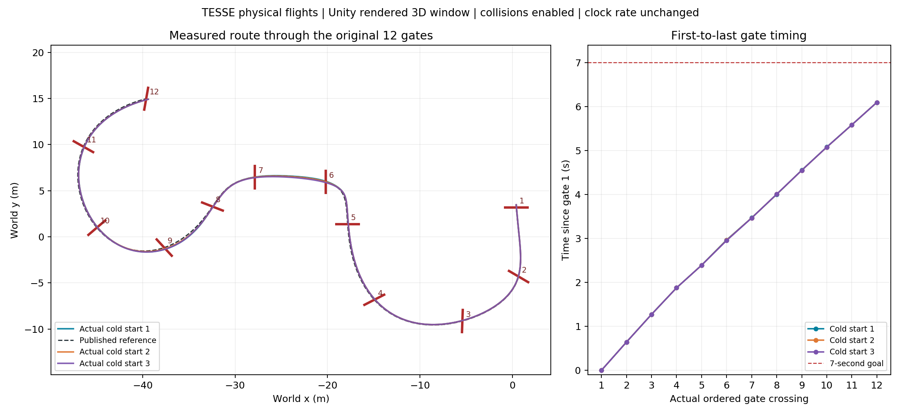
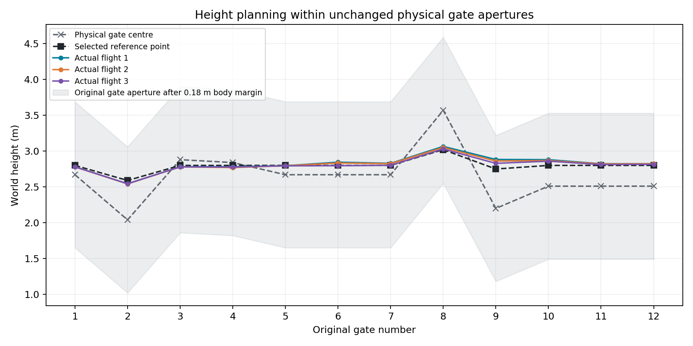
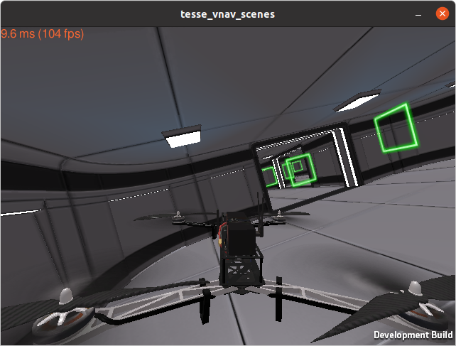

# VNAV Lab4 三维竞速优化版：约 6.1 秒

在 Unity 三维窗口中竞速，基于原来约 6.95 秒的版本继续优化。上游为 <https://github.com/Peichen-Shi/Robot-2026-8/tree/main/lab4>，固定提交 `8f8f7af6668fbb2b51136e9c6570a54eb09300c7`。

## 成绩与计时

**成绩是实际通过第 1 个门到实际通过第 12 个门的仿真用时**，不含准备悬停、第一门前的接近段及最后一门后的刹停。参考轨迹总长 8.85 秒：接近段 0.95 秒、门间计划时间 6.1 秒、刹停段 1.8 秒。

<!-- RESULTS_START -->
| Unity 三维窗口实测 | 第 1 门至第 12 门用时 | 通过门点 | 最小剩余门框余量 |
|---|---:|---:|---:|
| 独立重启 1 | 6.098144 s | 12/12 | 0.337 m |
| 独立重启 2 | 6.098465 s | 12/12 | 0.359 m |
| 独立重启 3 | 6.098037 s | 12/12 | 0.391 m |
| 默认一键启动复测 | 6.097876 s | 12/12 | 0.339 m |

三次独立重启和一次完整默认启动均通过原赛道竞速验收，无任务内碰撞。相对用户此前观察的约 6.971 秒，本次约快 0.87 秒（约 12.5%）；前者来自此前观察值，表中四次为本版本重新录包测量值。







截图记录竞速后的终点场景；成绩依据录包中的实际过门事件计算。

<!-- RESULTS_END -->

验收沿用原赛道 12 门、正向依序通过、2.4 m × 2.4 m 门孔和 0.18 m 机体余量；碰撞遥测开启，要求任务内无碰撞、控制故障或时钟重置，并核验参考轨迹执行至终点及末段稳定。参考结束后继续观察 8 秒；短竞速记录不代替作业中另行要求的 60 秒终点悬停测试。

## 在当前 Ubuntu 中启动

```bash
bash ~/lab4_sub7_20261025/run_3d_race.sh
```

脚本自动打开 Unity 三维赛道，检查通信、完成准备悬停，再开始比赛，无需另外开终端发送门点。原来的 `bash ~/lab4_sub7_20261025/run_optimized.sh` 也会启动相同的快速三维版本。

默认不额外打开 RViz。三维窗口中的飞行来自真实 ROS 闭环控制，没有使用回放，没有改变 `/clock` 的倍率，没有在比赛过程中重设实际位置。终端显示 `FINISHED ... 12/12` 后，等待独立分析输出 `ACCEPTED`；随后保持终点悬停。按 `Ctrl+C` 退出，再执行相同命令即可重新比赛。

日志和录包保存在该目录的 `results/` 下，每次使用独立名称。启动脚本带运行锁，防止两个进程同时控制无人机。运行前先结束其他 Lab3/Lab4 飞行启动终端。

原约 6.95 秒、以门中心为目标的版本已保留：

```bash
bash ~/lab4_sub7_20261025/run_3d_695.sh
```

本次所有源码和编译结果位于独立目录 `~/lab4_sub7_20261025`。`vnav_ws3`、`vnav_ws4` 的源码保持原状，仅从既有 `vnav_ws4/devel` 读取依赖。

## 本次修改

1. **在原门孔内优化高度**：按本次确认的要求，过门点可以偏离几何中心。横向目标仍取各门中心，高度向 2.8 m 平滑，单门竖直偏移最多 0.55 m。门的位置、尺寸、顺序、偏航和碰撞体均不变。规划目标扣除机体余量后，名义门框余量至少 0.47 m；实际余量由录包中的原始门孔检测计算。
2. **缩短分段时间**：`optimization/planner_profiles/sub7.yaml` 保存 13 段时间及门内偏移量。仍使用连续最小 snap 多项式求解，不靠加速时钟或录包播放。
3. **补偿参考延迟**：`reference_prediction.h` 将参考指令按时间戳预测到当前测量时刻，最多补偿 40 ms，本次通常为 20 ms。使用参考加速度估计 jerk，保留重复仿真时间戳的导数历史。实际里程计和录包中的规划参考不变，诊断误差仍相对原始参考计算。
4. **提高仿真指令上限**：`kx=16, kv=8, kr=24, komega=4` 保持原值；推力上限从 50 提高至 75，滚转/俯仰力矩上限从 8 提高至 12，偏航力矩上限从 5 提高至 7。质量、惯量、重力、旋翼系数和 Unity 场景不变。
5. **保留稳定措施**：准备和终点悬停使用几何 PD，飞行阶段启用 SO(3) 前馈；前馈角速度超限时限幅，不反复清空历史。状态、参考及旋翼看门狗保持开启。

原代码中的说明注释保留，新增逻辑就近注释。精确差异见 `OPTIMIZATION.patch`，原始 Git blob 哈希见 `UPSTREAM_MANIFEST.json`。`optimization/phase2/` 保存调参候选及原 6.95 秒配置；候选文件不代表全部通过验收。

## 核验资料

- `evidence/verification_summary.json`：选定完整实测的成绩汇总。
- `evidence/*/*.bag`、`parameters.yaml`、`startup.json`：真实录包、当次参数及 Unity 三维启动参数。
- `evidence/*/analysis/gate_crossings.csv`：按原始物理门框逐门验收，含正向通过、实际位置和剩余余量。
- `evidence/*/analysis/selected_gate_targets.csv`：物理门中心与选定门内规划点的对应关系。
- `evidence/*/analysis/numerics_audit.json`：独立重建多项式，检查选定点约束、偏航约束、C4 连续性及录包参考一致性。
- `evidence/trial_summary.csv`：包含探索过程的失败记录；漏门的部分用时不计作完整比赛成绩。
- `evidence/race_comparison.png`、`gate_height_comparison.png`：实际轨迹、逐门时间和门内高度选择。
- `evidence/validation/ctest_prediction.log`：电机分配、坐标转换、SO(3) 前馈及参考预测测试结果。

重新做三次独立重启测试：

```bash
bash ~/lab4_sub7_20261025/verify_sub7.sh
```

该脚本默认使用 Unity 三维窗口。需要留存录包时，应等待每次独立分析结束。

## 从压缩包重新构建

压缩包包括源码、参数、启动脚本和实测记录，不包括 Unity 二进制及编译缓存。保留当前机器中的 `~/vnav-builds/lab4` 和依赖工作空间，在解压后的新目录执行：

```bash
bash install.sh
bash run_3d_race.sh
```

`install.sh` 默认使用 `~/vnav_ws4/devel` 中的依赖，在自身的 `ros_ws` 编译。如依赖目录不同，先设置 `LAB4_UNDERLAY=/实际依赖目录/devel`。
