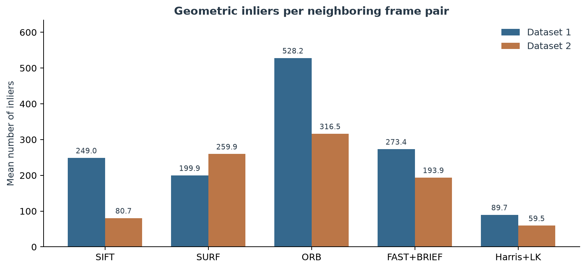

# Lab5 无人机视觉跟踪

[返回课程首页](../README.md) · [中文报告](deliverables/LAB5_无人机视觉跟踪实验报告.pdf) · [English report](deliverables/LAB5_Visual_Tracking_Report_EN.pdf) · [代码入口](feature_tracking/README.md) · [截图与数据](screenshots/README.md)

同一个盒子，换个角度还能认出来吗？Lab5 先用两张照片比较配对方法，再把同样的问题放进两段视频。

| 方法 | 一句话看懂 |
| --- | --- |
| SIFT / SURF / ORB / FAST＋BRIEF | 给特征点做“指纹”，到下一张图里找最像的点 |
| Harris＋LK | 选出好认的角点，看看它在下一帧挪了多远 |
| Farneback | 给整幅画面画一张运动地图 |

[English guide](README_EN.md)

## 先看什么

| 想了解的内容 | 入口 |
| --- | --- |
| 理论、实验步骤、结果与讨论 | [中文 PDF](deliverables/LAB5_无人机视觉跟踪实验报告.pdf) / [English PDF](deliverables/LAB5_Visual_Tracking_Report_EN.pdf) |
| 实验的真实运行画面 | [17 张编号截图](screenshots/README.md) |
| 各算法表现差异 | [7 张统计与流程图](charts/README.md) |
| 可重新计算的原始数据 | [CSV 与统计字段说明](results/README.md) |
| ROS代码与离线评估 | [C++ 源码](feature_tracking/src) |
| 编译和验证证据 | [日志与验证说明](logs/README.md) |

## 已完成的任务

| 交付项 | 实现内容 | 对应证据 |
| --- | --- | --- |
| D1 D2 | 球体投影、消失点与平行条件推导 | 报告第4节 |
| D3 D4 D5 | SIFT检测、128维描述、FLANN、距离比与RANSAC | 截图03至06、双图CSV |
| D6 | SIFT SURF ORB真实序列比较 | 两段完整CSV及图19至24 |
| 可选D6 | FAST检测与BRIEF描述 | 截图09与各方法表格 |
| D7 | Harris角点与金字塔LK | 截图12、13、17 |
| 可选D8 | Farneback稠密光流 | 截图14、15及self_flow.cpp |

## 实测结果与统计含义

| 方法 | 第一段平均内点 | 第二段平均内点 | 第一段耗时ms | 第二段耗时ms |
| --- | ---: | ---: | ---: | ---: |
| SIFT | 249.0 | 80.7 | 49.07 | 105.63 |
| SURF | 199.9 | 259.9 | 44.68 | 135.19 |
| ORB | 528.2 | 316.5 | 8.50 | 12.53 |
| FAST_BRIEF | 273.4 | 193.9 | 1.92 | 1.65 |
| LK | 89.7 | 59.5 | 2.07 | 5.21 |

第一段RGB话题 `/camera/color/image_raw`：1584张图像，1583个相邻帧对。第二段 `/tesse/left_cam/rgb/image_raw`：1386张图像，1385个帧对。所有方法使用完整序列，不抽样。

- 内点率先在每个帧对计算 `inliers/good`，再取平均；它不是累计内点除以累计候选。
- LK的`raw`和`good`都指状态有效且未越界的跟踪点，没有描述子距离比。LK的`keypoints2`也不是第二帧独立检测数。
- 内点表示符合估计的基本矩阵，不等于人工标注的匹配准确率；平面场景可能退化。
- 计时包含检测、描述、匹配和几何验证，不包含读取、绘图或截图；虚拟机调度会影响时间。



## 代码怎么读

| 文件 | 一句话说明 |
| --- | --- |
| `src/track_features.cpp` | ROS入口：选择方法，读取双图或订阅视频图像 |
| `src/feature_tracker.cpp` | 描述子公共流程：检测→描述→匹配→几何验证→绘图→统计 |
| `src/sift_feature_tracker.cpp` | SIFT适配：浮点描述子用FLANN匹配 |
| `src/surf_feature_tracker.cpp` | SURF适配：Hessian检测和浮点匹配 |
| `src/orb_feature_tracker.cpp` | ORB适配：二值描述子用Hamming距离 |
| `src/fast_feature_tracker.cpp` | FAST只检测点，BRIEF另外计算描述子 |
| `src/lk_feature_tracker.cpp` | 持续保存前帧和角点，跟踪点少时重新检测 |
| `src/self_flow.cpp` | 连续接收图像，计算Farneback稠密光流 |
| `src/evaluate.cpp` | 逐个读取rosbag，只选一个RGB话题，输出完整逐帧CSV |
| `include/` | 对外接口、成员状态和方法声明 |

注释说明“为什么做”和输入输出约定；按检测、匹配、几何与统计分步骤排列。统一使用Google风格、100列宽。整理前后15个C++文件的非注释标记一致；重新编译及双图复核通过，原始统计结果保留。

## 环境与首次配置

运行环境为Ubuntu 20.04、ROS Noetic、GCC 9.4、OpenCV 4.2.0 contrib，需开启`OPENCV_ENABLE_NONFREE`。普通Ubuntu OpenCV包可能不包含所需SIFT/SURF模块。

| 步骤 | 操作 | 完成后看到什么 |
| --- | --- | --- |
| 1. 准备环境 | 按下面的命令构建 OpenCV 和 ROS 节点 | 编译完成，ROS 能找到 lab_5 |
| 2. 先跑双图 | 用同一对盒子照片切换算法 | 特征点与匹配连线 |
| 3. 回放视频 | 指定一个 ROS bag，再选择算法 | 连续匹配或 LK 轨迹 |
| 4. 离线评估 | 逐对读取画面 | 两组分别得到 1583、1385 对的 CSV 统计 |

```bash
git clone https://github.com/Peichen-Shi/Robot-2026-8.git ~/Robot-2026-8
export LAB5_ROOT="$HOME/lab5_complete"
mkdir -p "$LAB5_ROOT"/{sources,data,results,logs,screenshots,ws/src}
cp -r ~/Robot-2026-8/lab5/feature_tracking "$LAB5_ROOT/ws/src/"
bash ~/Robot-2026-8/lab5/scripts/build_opencv.sh
source /opt/ros/noetic/setup.bash
cd "$LAB5_ROOT/ws"
catkin_make -DOpenCV_DIR="$LAB5_ROOT/opencv/lib/cmake/opencv4" -DCMAKE_BUILD_TYPE=Release
source devel/setup.bash
export LD_LIBRARY_PATH="$LAB5_ROOT/opencv/lib:$LD_LIBRARY_PATH"
```

系统需已有ROS的`roscpp`、`rosbag`、`image_transport`、`cv_bridge`，以及CMake、GCC、glog开发库和GTK开发库。OpenCV源码构建脚本会下载官方4.2.0源码和contrib，不把旧opencv3_catkin混入当前构建。

## 运行双图或实时视频

```bash
roslaunch lab_5 two_frames_tracking.launch descriptor:=SIFT
# 描述子可选 SIFT、SURF、ORB、FAST；窗口会在程序结束后关闭。

roslaunch lab_5 video_tracking.launch descriptor:=LK   path_to_dataset:=$HOME/lab5_complete/data/30fps_424x240_2018-10-01-18-35-06.bag
# 视频方法可选 SIFT、SURF、ORB、FAST、LK；Ctrl+C结束。
```

离线评估器的方法名使用`FAST_BRIEF`，ROS节点使用`FAST`，两者都表示FAST检测与BRIEF描述。

## 下载数据并完整评估

仓库不提交约2.1 GiB的原始bag和构建目录。原始文件在本次桌面`LAB5_VNAV/data`及虚拟机`~/lab5_complete/data`中保留，下载源为[官方数据说明](https://github.com/MIT-SPARK/VNAV-lab-data)。

```bash
python3 ~/Robot-2026-8/lab5/scripts/download_individual.py
bash ~/Robot-2026-8/lab5/scripts/run_all.sh
```

`run_all.sh`固定读取`~/lab5_complete/data`，等待两个数据文件就绪后评估全部帧对。输出在`~/lab5_complete/results/dataset1`和`dataset2`。单独运行：

```bash
mkdir -p ~/lab5_complete/results/check
rosrun lab_5 lab5_evaluate bag   ~/lab5_complete/data/vnav-lab5-smooth-trajectory.bag   ~/lab5_complete/results/check SIFT
```

最后的方法参数可换为`SURF`、`ORB`、`FAST_BRIEF`、`LK`或`FLOW`。`FLOW`保存代表性帧的稠密光流；`self_flow`节点则能连续计算。

## 重新生成图表与报告

图表仅依赖保存的CSV，不必重新运行实验：

```bash
python -m pip install -r lab5/scripts/requirements-report.txt
python lab5/scripts/make_report_charts.py
python lab5/scripts/build_bilingual_reports.py
```

图表生成可跨平台运行。当前PDF排版脚本在Windows上使用宋体与黑体，输出到`lab5/deliverables`；这与Ubuntu上的实验运行环境不同。`report_content_cn.py`和`report_content_en.py`仅供新版排版器读取正文，不是推荐的生成入口。

## 截图、图表与引用

- 截图文件名按`01_环境`到`17_ROS视频`编号，具体中文和英文说明见[screenshots/README.md](screenshots/README.md)。文件名保留方法和用途，报告中图号与索引一致。
- 图18至24位于`charts`，每张都有PNG和矢量PDF；时序图采用51帧对后向均值，但报告均值表仍读取全部原始数据。
- 报告的[1]至[6]引用题面、代码和官方API，[7]引用本实验测量。截图和CSV各自保留SHA256或校验记录。
- 排版参考个人实验归档中的Lab3/Lab4；代码模板来自MIT-SPARK VNAV2021（2443ec7e491001d09ab8dd66f6b953177043b784）。OpenCV与课程资料的权利归原作者，实验结果和实现修改见本目录。
